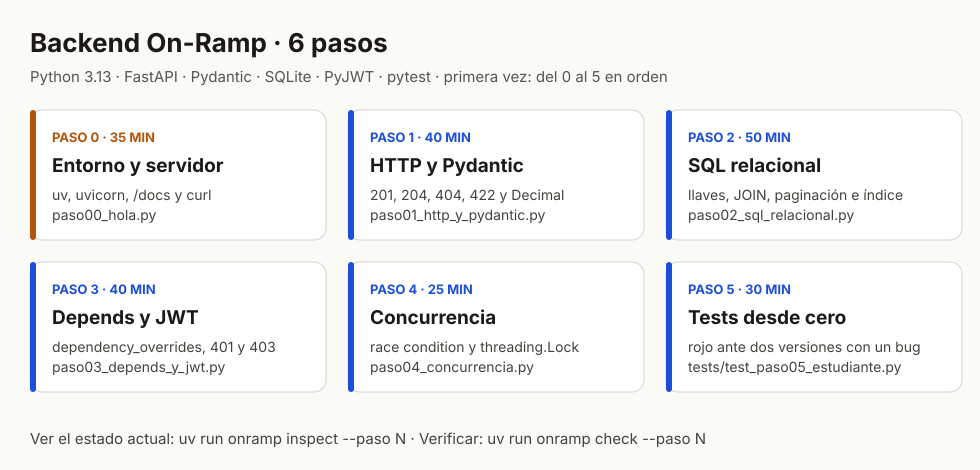

# Biblioteca — Backend On-Ramp

Este repositorio es un on-ramp, una nivelación práctica para llegar con lo mínimo al [Curso 1 de Backend con FastAPI](https://github.com/ykro/backend-course). Está pensado para estudiantes que ya programan (estructuras de datos, algoritmos, orientación a objetos) pero nunca han construido una aplicación web ni han usado una base de datos. Todo gira alrededor de una biblioteca pequeña con libros, autores, salas de estudio y multas, y corre en tu computadora con Python y SQLite, sin Docker ni cuentas externas.

## Por dónde empezar

Si es tu primera vez con aplicaciones web, sigue los pasos del 0 al 5 en orden; el recorrido completo toma unas cuatro horas. Para la Unidad 1 bastan los pasos 0, 1, 3 (solo el `TODO 1`) y 5, unas dos horas; haz los pasos 2 y 4 antes de la Unidad 2 y el resto del Paso 3 antes de la Unidad 3.

Cada paso sigue la misma forma. Empieza con tres preguntas para pensar antes de tocar código, explica por qué importa para el curso, te pide leer, debuguear y escribir algo pequeño, y cierra con preguntas sobre un caso nuevo. Si te trabas, cada paso tiene tres pistas que van de la idea general a un esqueleto de código.

| Paso | Tiempo | Qué practicas | Archivo | Guía |
| --- | --- | --- | --- | --- |
| Paso 0 | 35 min | Instalar `uv`, levantar tu primer servidor y hablarle con el navegador, `/docs` y `curl` | [paso00_hola.py](paso00_hola.py) | [steps/00-entorno-y-primer-servidor](steps/00-entorno-y-primer-servidor/README.md) |
| Paso 1 | 40 min | Códigos HTTP (`201`, `204`, `404`, `422`), estado aislado y validación con Pydantic y `Decimal` | [paso01_http_y_pydantic.py](paso01_http_y_pydantic.py) | [steps/01-http-y-pydantic](steps/01-http-y-pydantic/README.md) |
| Paso 2 | 60 min | Tu primera base de datos, tablas, llaves foráneas, `JOIN`, paginación con parámetros e índices en SQLite | [paso02_sql_relacional.py](paso02_sql_relacional.py) | [steps/02-sql-relacional](steps/02-sql-relacional/README.md) |
| Paso 3 | 40 min | `Depends` y `dependency_overrides`, qué trae un JWT y la diferencia entre `401` y `403` | [paso03_depends_y_jwt.py](paso03_depends_y_jwt.py) | [steps/03-depends-y-jwt](steps/03-depends-y-jwt/README.md) |
| Paso 4 | 25 min | Requests simultáneos, race conditions y `threading.Lock` | [paso04_concurrencia.py](paso04_concurrencia.py) | [steps/04-concurrencia](steps/04-concurrencia/README.md) |
| Paso 5 | 30 min | Tests desde cero con `pytest` que se ponen en rojo ante dos versiones con un bug | [tests/test_paso05_estudiante.py](tests/test_paso05_estudiante.py) | [steps/05-pruebas-desde-cero](steps/05-pruebas-desde-cero/README.md) |

## Inicio rápido

1. Instala [uv](https://docs.astral.sh/uv/getting-started/installation/) y clona este repositorio con `git clone https://github.com/ykro/backend-onramp.git` (el [Paso 0](steps/00-entorno-y-primer-servidor/README.md) explica la terminal si nunca la has usado).
2. Corre `uv sync` en la raíz. `uv` descarga Python 3.13 y las dependencias del proyecto.
3. Sigue el [Paso 0](steps/00-entorno-y-primer-servidor/README.md) para levantar tu primer servidor.
4. En cada paso, mira el comportamiento actual con `uv run onramp inspect --paso N` y verifica tu avance con `uv run onramp check --paso N`. Sin `--paso`, los comandos corren todos los pasos.

## Errores comunes al preparar el entorno

| Lo que ves | Qué significa | Qué hacer |
| --- | --- | --- |
| `uv: command not found` | `uv` no está instalado o la terminal no ve su carpeta | Instálalo con la [guía oficial](https://docs.astral.sh/uv/getting-started/installation/), cierra y abre la terminal |
| `uv sync` reporta permisos en la caché | Tu usuario no puede escribir en la caché global | En macOS y Linux `UV_CACHE_DIR=/tmp/uv-cache-onramp uv sync`; en PowerShell `$env:UV_CACHE_DIR="$env:TEMP\uv-cache"; uv sync` |
| `Address already in use` al correr `uvicorn` | Otro servidor sigue usando el puerto `8000` | Ciérralo con `Ctrl+C` o agrega `--port 8001` |
| `ModuleNotFoundError: No module named 'fastapi'` | Corriste `python` en lugar de `uv run python` | Antepón `uv run` a cada comando |
| El navegador dice que no puede conectarse | El servidor no está corriendo | Revisa la terminal donde lanzaste `uvicorn`; debe decir `Uvicorn running on http://127.0.0.1:8000` |

## Lecturas cortas y uso de IA

- El [glosario](docs/glosario.md) explica cada término con un enlace a la documentación oficial.
- [Cómo leer un ADR](docs/adr-ejemplo.md) te prepara para el `ARCHITECTURE_DECISIONS.md` del curso.
- [Qué es la Integración Continua (CI)](docs/ci.md) explica qué corre GitHub Actions cuando haces push.
- Puedes usar tu asistente de IA (Claude Code, Antigravity, Codex o Gemini CLI). [AGENTS.md](AGENTS.md) le pide que te guíe con preguntas y pistas antes de mostrarte código. Si aceptas código que no puedes explicar con tus palabras, el on-ramp pierde su sentido.

## Repositorios relacionados

- Índice de on-ramps: [ykro/courses-onramp](https://github.com/ykro/courses-onramp)
- Curso principal: [ykro/backend-course](https://github.com/ykro/backend-course)
- Solución de referencia, con las respuestas de autoevaluación de cada paso: [ykro/backend-onramp-solution](https://github.com/ykro/backend-onramp-solution)
